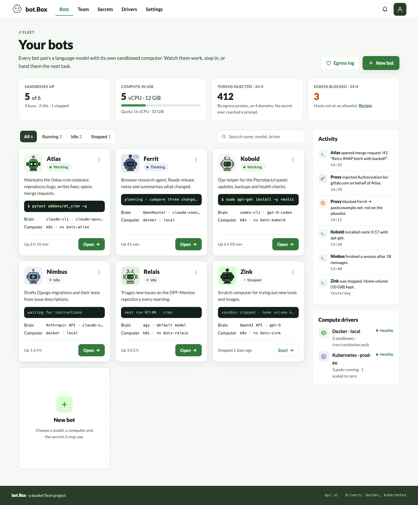
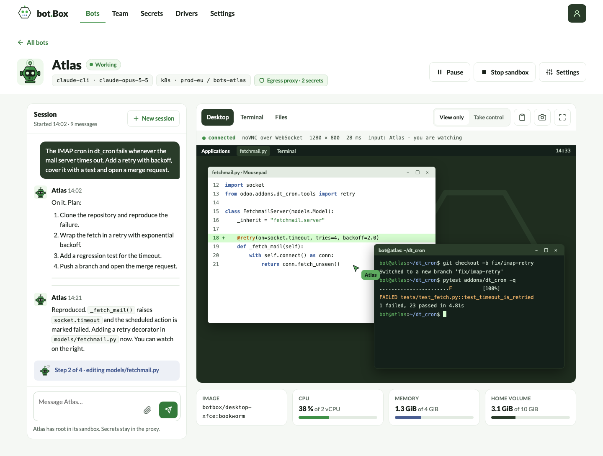

# bot.Box designs

High-fidelity designs for bot.Box, styled after [dunkel.tech](https://dunkel.tech). The rules behind them (colour, type, components, avatars, accessibility) are in [`STYLEGUIDE.md`](STYLEGUIDE.md), and the raw values are in [`tokens.json`](tokens.json).

| Folder | Contents |
|---|---|
| [`screens/`](screens/) | PNG exports of every screen at 1440 px width |
| [`source/`](source/) | Source files from the design canvas (`.dc.html` plus `canvas.json`). They are reference markup with exact inline styles and need the canvas runtime to render. |

The interactive canvas (clickable prototype with live avatars) lives in Claude: <https://claude.ai/artifact/5G96Q8BbhbtnvJsH1QvVu8>. It is private until shared from the page's **Share** menu.

## Screens

| Screen | File | Used in |
|---|---|---|
| Fleet dashboard | [`fleet-dashboard.png`](screens/fleet-dashboard.png) | Phase 1, 4, 7 |
| Bot workspace: chat + live computer | [`bot-workspace.png`](screens/bot-workspace.png) | Phase 2, 4, 5 |
| New bot | [`new-bot.png`](screens/new-bot.png) | Phase 1, 4, 7 |
| Secrets & egress proxy | [`secrets-egress.png`](screens/secrets-egress.png) | Phase 3 |
| Team chat: group with bot-to-bot talk | [`team-group-chat.png`](screens/team-group-chat.png) | Phase 6 |
| Team chat: direct message | [`team-direct-message.png`](screens/team-direct-message.png) | Phase 4, 6 |
| Team chat: new group | [`team-new-group.png`](screens/team-new-group.png) | Phase 6 |
| Robot avatar system | [`avatar-system.png`](screens/avatar-system.png) | Phase 1 |

### Fleet dashboard
Bots as cards with live robot avatars, status, current activity, brain and computer. Also: fleet stats, an activity feed (including egress events) and driver health.

### Bot workspace
Chat with the bot on the left. On the right, its live XFCE desktop over noVNC, with tabs for Desktop, Terminal and Files, the bot's labelled cursor, "View only / Take control" and resource meters.

### New bot
Sections: Identity with a seeded avatar and reroll, Brain (agent CLI in the sandbox or a model API), Computer (Docker or Kubernetes, image, resources, persistent home), and Secrets & network. A live preview shows what gets created.

### Secrets & egress proxy
How a secret leaves the sandbox, write-only secrets, the outbound allowlist and a filterable egress log.

### Team chat
Bots appear as colleagues in a Slack-style sidebar, next to direct messages and group chats in which bots hand work to each other with mentions, within turn limits and approvals.

### Robot avatars
A deterministic robot per seed, with moods that follow the bot's status.

## Known gaps

These screens still need designs before their phase starts:

- Login, invitation and workspace switcher, plus workspace members and roles (Phase 1)
- Budget settings and the "Spend today" tile (Phase 4)
- Computer-use action timeline (Phase 5)
- Humans as group participants and the approvals inbox (Phase 6)
