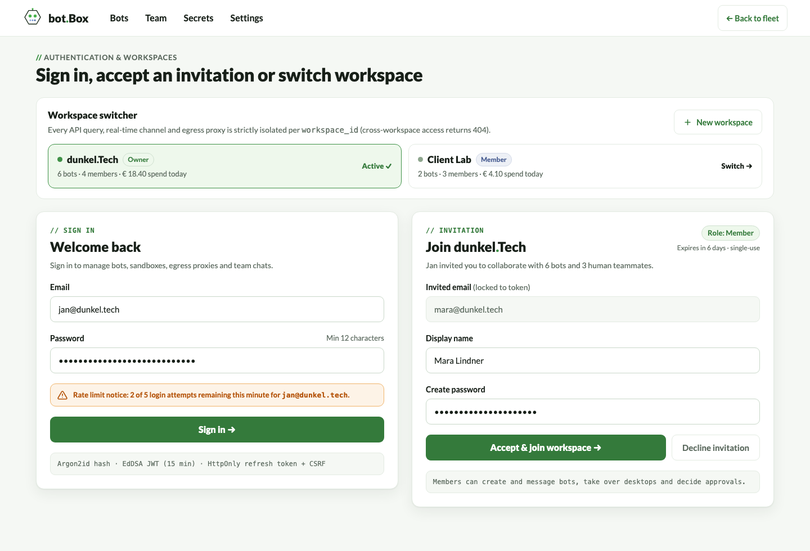
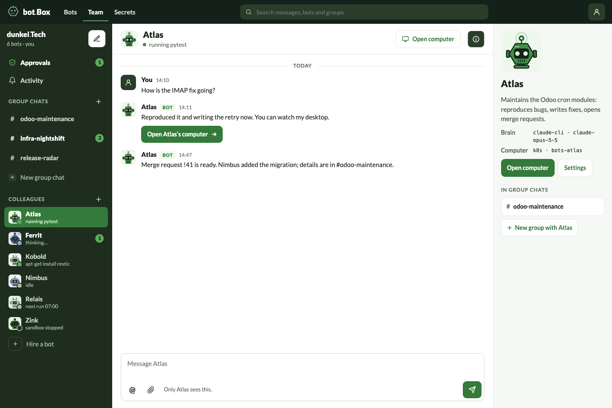
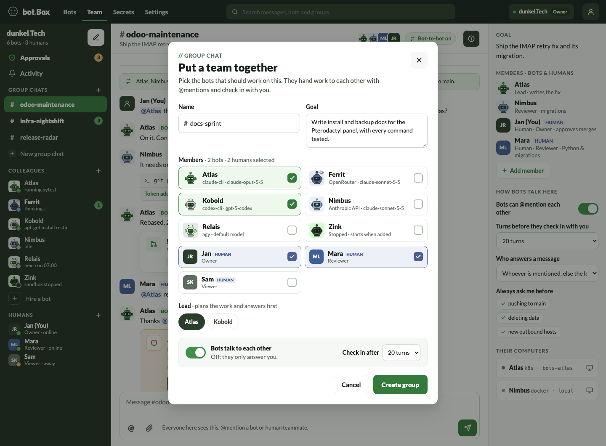
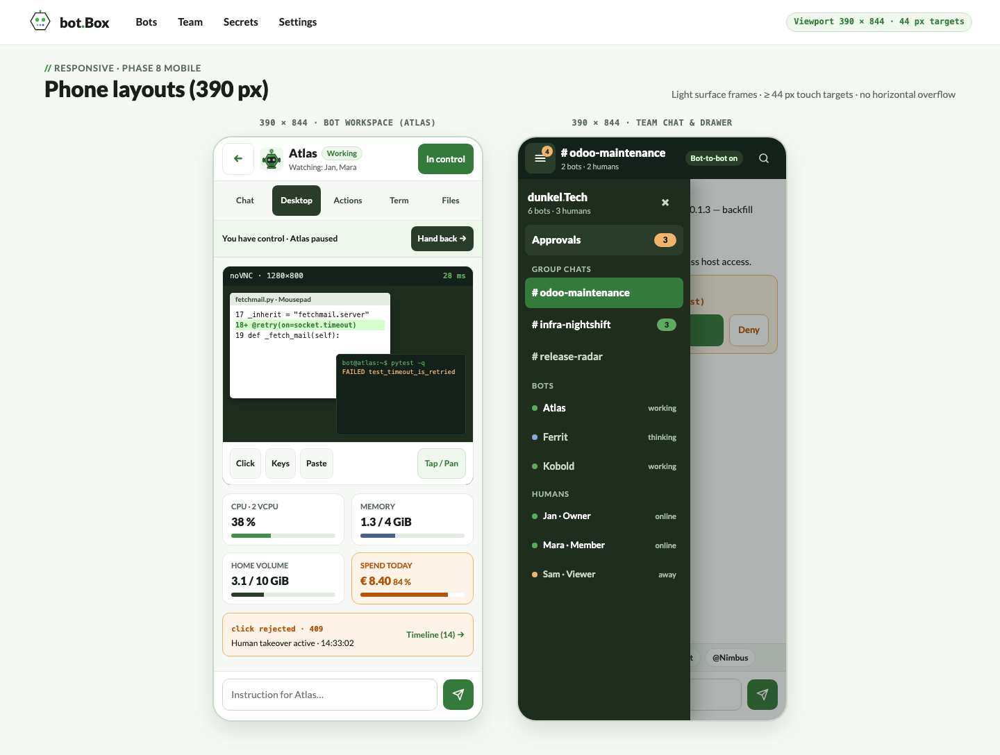

# bot.Box designs

High-fidelity designs for bot.Box, styled after [dunkel.tech](https://dunkel.tech). The rules behind them (colour, type, components, avatars, accessibility) are in [`STYLEGUIDE.md`](STYLEGUIDE.md), and the raw values are in [`tokens.json`](tokens.json).

| Folder | Contents |
|---|---|
| [`screens/`](screens/) | PNG exports of every screen at 1440 px width |
| [`source/`](source/) | Source files from the design canvas (`.dc.html` plus `canvas.json`). They are reference markup with exact inline styles and need the canvas runtime to render. |

The interactive canvas (clickable prototype with live avatars) lives in Claude: <https://claude.ai/artifact/5G96Q8BbhbtnvJsH1QvVu8>. It is private until shared from the page's **Share** menu.

## Screens

| Screen | File | Used in |
|---|---|---|
| Fleet dashboard | [`fleet-dashboard.png`](screens/fleet-dashboard.png) | Phase 1, 4, 7 |
| First-run setup wizard | [`setup-wizard.png`](screens/setup-wizard.png) | Phase 1 |
| Sign in, invitation & workspace switcher | [`auth-login-invite.png`](screens/auth-login-invite.png) | Phase 1 |
| Workspace members, roles & budgets | [`workspace-settings.png`](screens/workspace-settings.png) | Phase 1, 4 |
| Bot workspace: chat + live computer + action timeline | [`bot-workspace.png`](screens/bot-workspace.png) | Phase 2, 4, 5 |
| New bot | [`new-bot.png`](screens/new-bot.png) | Phase 1, 4, 7 |
| Secrets, egress proxy & bot budgets | [`secrets-egress.png`](screens/secrets-egress.png) | Phase 3, 4 |
| Team chat: group with humans, mentions & approvals | [`team-group-chat.png`](screens/team-group-chat.png) | Phase 6 |
| Team chat: approvals inbox | [`team-approvals-inbox.png`](screens/team-approvals-inbox.png) | Phase 6 |
| Team chat: direct message | [`team-direct-message.png`](screens/team-direct-message.png) | Phase 4, 6 |
| Team chat: new group (bots & humans) | [`team-new-group.png`](screens/team-new-group.png) | Phase 6 |
| Phone layouts (390 px): Workspace & Team chat | [`phone-layouts.png`](screens/phone-layouts.png) | Phase 8 |
| Robot avatar system | [`avatar-system.png`](screens/avatar-system.png) | Phase 1 |

### Fleet dashboard
Bots as cards with live robot avatars, status, current activity, brain and computer. Includes the workspace switcher pill, a "Spend today" overview tile (€ 18.40 of € 30.00, 61 %, token and subscription CLI counts), activity feed and driver health.

### First-run setup wizard
Displayed automatically while the server has zero registered users (`setupRequired: true`). Shows the one-time server setup secret prompt (with constant-time SHA-256 verification and rate-limit notice), initial `Owner` account fields, first workspace setup (slug, Docker/Kubernetes default driver, reply language), live server stdout terminal preview, and completion invariants (`/api/setup/*` locks to `404` permanently once finished).

### Sign in, invitation & workspace switcher
Active workspace switcher bar with cross-workspace 404 isolation notice, password sign-in with rate-limit notice and session security footer (Argon2id, EdDSA, CSRF), paired side by side with invitation acceptance for a locked invitee email.

### Workspace members, roles & budgets
Workspace settings showing active members and roles, an interactive invite form and pending invitations list, monthly and daily workspace budget caps with 80 % warning / 100 % stop markers, editable per-bot daily caps, the `model_prices` rate table and the §4.1 RBAC permission matrix.

### Bot workspace
Chat with the bot on the left and its live XFCE desktop over noVNC on the right, with tabs for Desktop, Actions (`desktop_actions` timeline with 7-day screenshot retention note and amber `409` click-conflict state), Terminal and Files, human watcher indicator, "You have control" takeover hand-back bar with note field, and resource meters.

### New bot
Sections: Identity with a seeded avatar and reroll, Brain (agent CLI in the sandbox or a model API), Computer (Docker or Kubernetes, image, resources, persistent home), and Secrets & network. A live preview shows what gets created.

### Secrets, egress proxy & bot budgets
How a secret leaves the sandbox, write-only secrets, the outbound allowlist, a filterable egress log, and per-bot daily/monthly budget meters (with 80 % amber warning, 100 % `429 BudgetExceeded` kill-switch state, and budget raise requests) alongside `usage_records`.

### Team chat
Bots and humans (`Owner`, `Reviewer`, `Viewer`) appear as colleagues in a Slack-style sidebar next to direct messages, `@` mention autocomplete, group chats with inline approval cards (`new_host`), bot-to-bot turn limits, the Approvals inbox (`Pending`, `Approved`, `Denied`) and the new-group dialog for both bots and humans.

### Phone layouts (390 px)
Mobile layouts at 390 px width for Bot Workspace (compact header, Desktop/Actions/Terminal/Files tabs, takeover banner, 16:10 XFCE viewport with 44 × 44 px `Tap / Pan` touch controls, 2×2 resource/budget grid and sticky composer) and Team Chat (top bar, open `dark-2` slide-over drawer over scrim with channels, Approvals badge, bots and humans, plus sticky composer).

### Robot avatars
A deterministic robot per seed, with moods that follow the bot's status.

